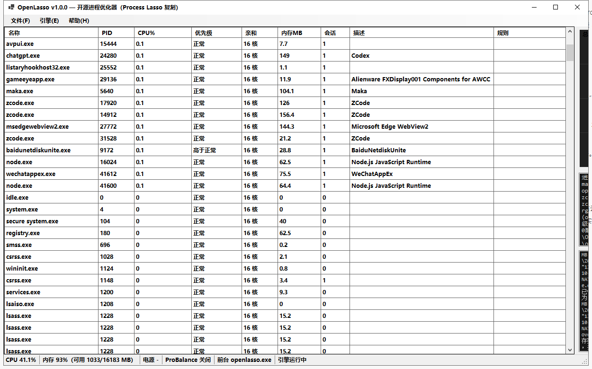

# OpenLasso

> Open-source process optimizer for Windows — an independent, clean-room reimplementation of Process Lasso's core engine (ProBalance-style CPU restraint, SmartTrim working-set trimming, persistent process rules, power-plan automation). C# / .NET 8 / WinForms, single-file build, zero third-party dependencies.

[](https://github.com/anaconda110/openlasso/actions/workflows/build.yml)
[](LICENSE)



**中文说明**：OpenLasso 是一个 Windows 进程优化器的开源实现，功能对标 Process Lasso 的核心引擎——CPU 超载时自动抑制后台进程（ProBalance 式）、智能内存整理（SmartTrim 式）、持久化进程规则（优先级/亲和性/IO 优先级/CPU 集/能效模式/实例限制/CPU 限额/黑名单/看门狗/保活）、电源计划自动化，并提供带 CPU 曲线与托盘图标的图形界面。**可直接读取现有 `prolasso.ini` 配置**。

## Features

| Feature | Status | Notes |
|---|:-:|---|
| ProBalance-style restraint | ✅ | Engages when total CPU ≥ threshold for N ms; per-process CPU gate; lowers priority (+ IO priority); restores on load drop / minimum restraint time; foreground / foreground-children / exclusion-list / services exclusions; auto-pause when system idle |
| Default priority / IO priority / memory priority | ✅ | `NtSetInformationProcess` / `SetProcessInformation` |
| Default affinity / CPU sets | ✅ | Hex mask or core list; `SetProcessDefaultCpuSets` |
| Efficiency mode (Eco) | ✅ | `ProcessPowerThrottling` (Win10 1709+) |
| SmartTrim working-set trimming | ✅ | Trims processes above a WSS floor when RAM load ≥ threshold, on an interval |
| Foreground boost | ✅ | Foreground process raised to Above Normal, restored on switch |
| Instance count limits | ✅ | Terminates the **newest** instance beyond the limit |
| Disallowed / allowed processes | ✅ | Pattern blacklist with terminate + log |
| CPU % limits | ✅ | Duty-cycle suspend/resume at 1 s period |
| Watchdog rules | ✅ | `name;cpu>50;mem>800;time>60;action=kill\|trim\|priority:x` |
| Keep running (auto-restart) | ✅ | Re-launches by recorded path on exit (no cmdline restore) |
| IdleSaver / load-based power switching | ✅ | Switches power schemes by idle time or rolling CPU average |
| CSV action log | ✅ | Same column layout as the original's log, rotated ×10, compatible action IDs |
| Config compatibility | ✅ | Reads existing `prolasso.ini`-style INI on first run (sections/keys aligned) |
| GUI | ✅ | Process table (sortable), CPU graph, dynamic tray icon (CPU %), rule & settings editors, headless self-test mode |
| GPU priorities, responsiveness graph, multi-language, service/session-agent split | ❌ | Out of scope for v1 (see Design notes) |

## Build & Run

Requires the .NET 8 SDK.

```bash
dotnet build -c Release                                        # build
dotnet publish -c Release -r win-x64 -o publish -p:PublishSingleFile=true   # single-file ~256 KB

OpenLasso.exe                 # GUI (process table + graph + tray)
OpenLasso.exe --minimized     # start hidden to tray (use this for autostart)
OpenLasso.exe --selftest      # headless self-test: 8 assertions over the engine
```

> Run as administrator to manage processes of other users; without elevation the engine degrades gracefully (failed actions are logged, never fatal).

## Configuration

Settings live in `C:\ProgramData\OpenLasso\config\openlasso.ini` (falls back to `%APPDATA%` without write permission). On first run, an existing `C:\ProgramData\ProcessLasso\config\prolasso.ini` is **read-only imported** so your current rules carry over. Section/key names are aligned with that format:

```ini
[OutOfControlProcessRestraint]
OocOn=true
TotalProcessorUsageBeforeRestraint=60
PerProcessUsageBeforeRestraint=5
TimeOverQuotaBeforeRestraint=900
MinimumTimeOfRestraint=4200
OocExclusions=code.exe,powershell.exe

[ProcessDefaults]
DefaultPriorities=code.exe,below normal
DefaultIOPriorities=code.exe,1
DefaultAffinitiesEx=vmware-vmx.exe,0xFF
CPUSets=blender.exe,0-7

[ProcessAllowances]
InstanceLimitedProcesses=chrome.exe,8
CPULimitRules=folding.exe,25
DisallowedProcesses=bloatware.exe
KeepRunningProcessesEx=critical-tool.exe
```

Patterns support `*` / `?` wildcards and match both the process name and (for path-like patterns) the full image path.

## Design notes

- **One process, one engine.** The original splits into a session-0 service (`ProcessGovernor.exe`), a per-session agent, and a GUI synchronised via named kernel events and a hidden notification window. OpenLasso runs the engine as a background thread inside the GUI process — no service, no session bridge, no elevation required for the basics.
- **Polling model.** Process enumeration is a 1 s `System.Diagnostics.Process` snapshot with per-PID CPU-time deltas (total CPU from `GetSystemTimes`), the same low-overhead approach as the original's `NtQuerySystemInformation` polling.
- **Everything through public APIs.** Priority, affinity, CPU sets, IO/memory priority, Eco mode, working-set trim, power schemes — all documented (or widely known) Windows APIs; no undocumented hooks, no drivers.
- **Verified headlessly.** `--selftest` spawns a sacrificial process and asserts snapshot capture, priority/affinity set + read-back, working-set trim, termination, and log output; the same assertions run in CI.

## Disclaimer

OpenLasso is **not affiliated with, endorsed by, or connected to Bitsum LLC**. "Process Lasso", "ProBalance" and "SmartTrim" refer to Bitsum's product and features and are used here solely descriptively for interoperability. This repository contains **no Bitsum code, binaries, or resources**; it is an independent implementation written from scratch against public Windows APIs, created for personal education and interoperability with the documented INI/log formats. No license-check circumvention is provided or discussed.

## License

[MIT](LICENSE) © 2026 anaconda110
